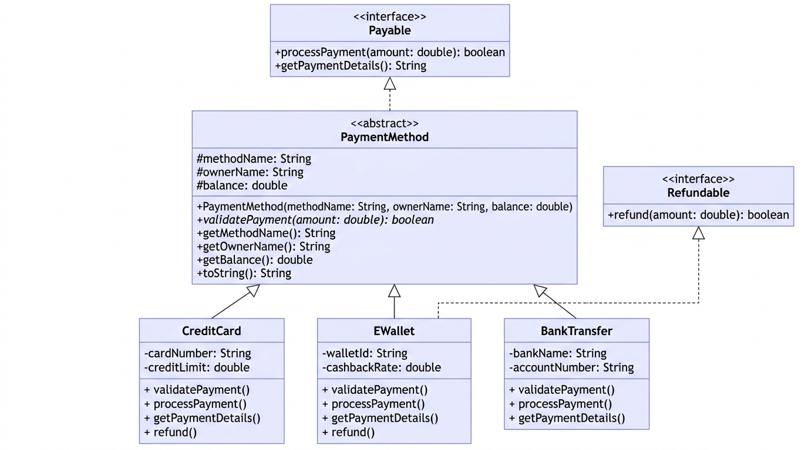

**Course:** PBO (Pemrograman Berorientasi Objek)  

**Topics:** Abstract Class, Interface, Inheritance, Polymorphism

**Name:** Made Agastya Devanantha Dharmawan (F1D02410071)


---

##  Class Diagram



---

## Project Structure

```
exercise case study/
├── README.md
├── class_diagram.jpg
└── src/
    ├── Payable.java             ← Interface
    ├── Refundable.java          ← Interface
    ├── PaymentMethod.java       ← Abstract Class
    ├── CreditCard.java          ← Concrete Class
    ├── EWallet.java             ← Concrete Class
    ├── BankTransfer.java        ← Concrete Class
    └── PaymentSystemDemo.java   ← Main (Demo)
```

---

##  Key OOP Concepts Demonstrated

### 1. Interface (`Payable`, `Refundable`)

An **interface** defines a contract — a set of method signatures that implementing classes **must** provide.

```java
public interface Payable {
    boolean processPayment(double amount);  // no body — just the signature
    String getPaymentDetails();
}
```

**Key properties:**
- All methods are implicitly `public abstract`
- All fields are implicitly `public static final`
- A class can implement **multiple** interfaces
- Interfaces define **capabilities** ("CAN-DO")

**In this project:**
- `Payable` → every payment method CAN process a payment
- `Refundable` → only **some** payment methods CAN issue refunds

---

### 2. Abstract Class (`PaymentMethod`)

An **abstract class** cannot be instantiated directly. It serves as a **blueprint** for subclasses.

```java
public abstract class PaymentMethod implements Payable {
    protected String methodName;
    protected String ownerName;
    protected double balance;

    public abstract boolean validatePayment(double amount);  // abstract — no body
    
    // Concrete methods can also exist
    public String getMethodName() { return methodName; }
}
```

**Key properties:**
- Can have **constructors** (called via `super()`)
- Can have **concrete methods** with implementations
- Can have **abstract methods** (no body)
- Can have **instance fields** (including `protected`)
- Defines an **"IS-A"** relationship

**Abstract Class vs Interface:**

| Feature | Abstract Class | Interface |
|---------|---------------|-----------|
| Constructor |  Yes |  No |
| Instance fields |  Yes |  Only constants |
| Concrete methods |  Yes |  Abstract only* |
| Multiple inheritance |  Single only |  Multiple |
| Relationship | "IS-A" | "CAN-DO" |


---

### 3. Inheritance (`extends`)

**Inheritance** allows a class to acquire fields and methods from a parent class.

```java
public class CreditCard extends PaymentMethod implements Refundable {
    
    public CreditCard(String ownerName, double balance, String cardNumber, double creditLimit) {
        super("Credit Card", ownerName, balance);  // ← calls parent constructor
        this.cardNumber = cardNumber;
        this.creditLimit = creditLimit;
    }
}
```

**In this project:**
- `CreditCard`, `EWallet`, `BankTransfer` all **extend** `PaymentMethod`
- They inherit: `methodName`, `ownerName`, `balance`, `getMethodName()`, `getOwnerName()`, `getBalance()`, `toString()`
- They **must** implement: `validatePayment()` (abstract), `processPayment()`, `getPaymentDetails()` (from Payable)

---

### 4. Polymorphism

**Polymorphism** = "many forms." The same method call behaves differently depending on the actual object type at runtime.

```java
PaymentMethod[] methods = { creditCard, eWallet, bankTransfer };

for (PaymentMethod method : methods) {
    method.processPayment(1000.00);  // ← calls the CORRECT version for each type
}
```

- `creditCard.processPayment()` → checks credit limit
- `eWallet.processPayment()` → applies cashback
- `bankTransfer.processPayment()` → direct bank deduction

The JVM determines **at runtime** which method implementation to execute — this is called **dynamic method dispatch**.

---

### 5. Additional Concepts

| Concept | Where It's Used |
|---------|----------------|
| `@Override` | All overridden methods in subclasses |
| `instanceof` | Checking if a PaymentMethod supports Refundable |
| Downcasting | `(Refundable) method` after instanceof check |
| `super()` | Subclass constructors calling parent constructor |
| `protected` | Fields in PaymentMethod accessible by subclasses |
| Encapsulation | Private fields with public getters in each class |

---

## Architecture Overview

This payment system is built to make adding new payment providers painless:

* `Payable` and `Refundable` interfaces split capabilities so methods only implement what they actually support.
* `PaymentMethod` (abstract class) handles shared state and validation logic to avoid boilerplate across providers.
* `CreditCard`, `EWallet`, and `BankTransfer` extend the base class with their own provider-specific execution.
* The checkout flow relies on polymorphism—it calls `.pay()` on the base type without caring which payment method is underneath.

To add a new provider like `CryptoPayment`, just extend `PaymentMethod` and implement the relevant interfaces. The core checkout logic doesn't need to be touched.
